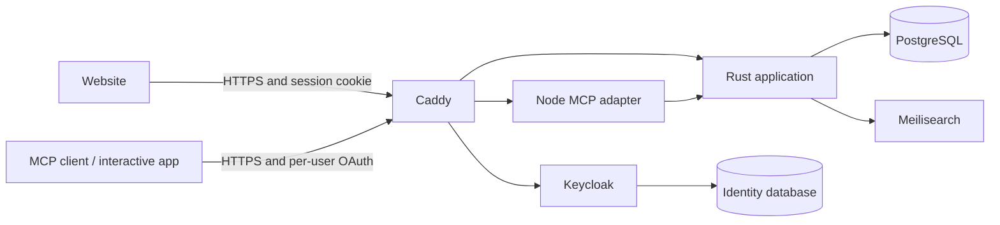

# GTD

**A self-hosted task system for people and AI assistants.**

<p align="center">
  
</p>

## Why GTD?

Keeping a detailed task system up to date can become a job of its own. GTD lets
your assistant handle that upkeep. Talk through a project, an idea, or a change
of plan, and your assistant can turn it into concrete actions, dependencies,
dates, and work blocks. Those details help GTD surface what needs your attention
next, without making you maintain every field yourself.

Your tasks also keep the useful context from those conversations: decisions,
progress, unresolved questions, and next steps. A fresh conversation or a
different assistant can read those notes and continue where you left off,
so you spend less time repeating yourself.

Use the website yourself or work through the interactive MCP app in ChatGPT or
Claude. Both use the same tasks and projects, with a separate account for each user.

## Features

### Priorities

See urgency and importance together. Tasks inherit priority from the work they
block, so a small prerequisite can get the attention a critical outcome deserves.
Select a square to browse its tasks.

### Task Context and Planning

Capture ideas in Inbox and clarify them into specific next actions. Keep a brief,
supporting notes, and agent notes alongside each task. Deadlines, Start by,
availability, estimates, and work blocks give the plan enough detail to be useful.


### Projects and Dependencies

Group actions around an outcome, see what is ready, and track what is waiting or
blocked. Someday keeps possibilities separate from current commitments.


### Activity and Reviews

Look back over a year of completed tasks, or inspect daily activity by the type
of change. Select a date to see the records behind it.


Audit history, undo, version checks, and retry-safe batches make changes
inspectable. Date-filtered history gives assistants the material for a weekly
recap without relying on the current conversation.

## Getting Started

| Goal | Guide |
| --- | --- |
| Run a full installation | [Self-hosting](docs/self-hosting.md) |
| Try the interface or contribute locally | [Development](docs/development.md) |
| Connect ChatGPT, Claude, or another MCP client | [Integrations](docs/integrations.md) |
| Learn the workflow and date semantics | [User guide](docs/user-guide.md) |
| Understand the implementation | [Architecture](docs/architecture.md) |
| Back up, restore, or upgrade | [Operations](docs/operations.md) |

Full self-hosting uses a Linux server, Docker Compose, Python 3.11+, and HTTPS
hostnames you control. The installation creates its own PostgreSQL, Keycloak,
Meilisearch, and application services. No model API key is required to run GTD.
Cloudflare Tunnel is optional. Host subscriptions and connector availability are
controlled by the host provider.

For a local development preview with disposable data:

```sh
npm --prefix web ci
npm --prefix adapter ci
npm --prefix web run build
cargo build --locked
node web/test-server.mjs
```

Open `http://127.0.0.1:18081`. This **test-only** preview has no login and discards
its database when stopped. Use the self-hosting guide for persistent accounts.
Requires Rust 1.93+, Node.js 24+, and a C toolchain.

## System Architecture



The website and widget share React components. Rust owns task behavior,
transactions, account isolation, and authorization. Keycloak owns sign-in and
OAuth. Internal services listen on loopback; Caddy exposes only intended routes.

## Contributing and License

See [CONTRIBUTING.md](CONTRIBUTING.md), [SECURITY.md](SECURITY.md), and
[the documentation index](docs/README.md).

Copyright © 2026 Chris Delvalle. Licensed under [AGPL-3.0-only](LICENSE).
Third-party components retain their own licenses; see [NOTICE](NOTICE).
GTD is independent of David Allen, OpenAI, and Anthropic.
