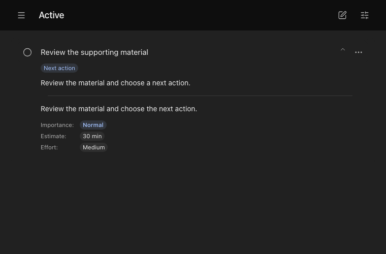
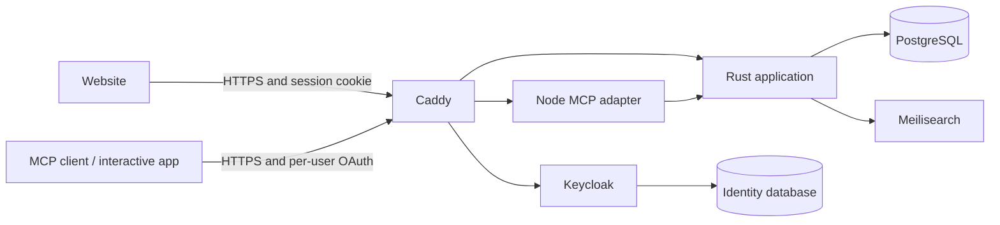

# GTD

**A self-hosted task system for people and AI assistants.**

Capture a loose thought, turn it into a concrete next action, and keep the context
needed to finish it. Use the website yourself, or let an MCP-compatible assistant
work with the same tasks and projects. Your next conversation can pick up where
the last one stopped.

GTD combines a Getting Things Done workflow with a shared website and interactive
MCP app for ChatGPT and Claude. Each invited user has a separate account.


## Features

- **One place for commitments.** Inbox, Next, Waiting, Blocked, Someday, projects,
  and reviews keep ideas separate from work you have committed to doing.
- **Useful context for assistants.** Briefs explain the action, human notes hold
  supporting detail, and agent notes preserve decisions, progress, and uncertainty.
- **Planning that respects dependencies.** Deadlines, Start by, availability,
  work blocks, effort, estimates, and inherited priorities help surface useful work.
- **A history you can trust.** Version checks, retry-safe requests, atomic batches,
  audit history, undo, and date-filtered recaps make changes inspectable.
- **Visual perspective.** Completion/activity heatmaps, stacked activity bars,
  and a priorities matrix show both recent progress and the work ahead.
- **Your infrastructure.** PostgreSQL holds authoritative data; search is derived.
  Invitations and per-account authorization keep personal task lists separate.



## Getting Started

| Goal | Guide |
| --- | --- |
| Run a full installation | [Self-hosting](docs/self-hosting.md) |
| Try the interface or contribute locally | [Development](docs/development.md) |
| Connect ChatGPT, Claude, or another MCP client | [Integrations](docs/integrations.md) |
| Learn the workflow and date semantics | [User guide](docs/user-guide.md) |
| Understand the implementation | [Architecture](docs/architecture.md) |
| Back up, restore, or upgrade | [Operations](docs/operations.md) |

Full self-hosting uses a Linux server, Docker Compose, Python 3.11+, and HTTPS
hostnames you control. The installation creates its own PostgreSQL, Keycloak,
Meilisearch, and application services. No model API key is required to run GTD.
Cloudflare Tunnel is optional. Host subscriptions and connector availability are
controlled by the host provider.

For a local development preview with disposable data:

```sh
npm --prefix web ci
npm --prefix adapter ci
npm --prefix web run build
cargo build --locked
node web/test-server.mjs
```

Open `http://127.0.0.1:18081`. This **test-only** preview has no login and discards
its database when stopped. Use the self-hosting guide for persistent accounts.
Requires Rust 1.93+, Node.js 24+, and a C toolchain.

## System Architecture



The website and widget share React components. Rust owns task behavior,
transactions, account isolation, and authorization. Keycloak owns sign-in and
OAuth. Internal services listen on loopback; Caddy exposes only intended routes.

## Contributing and License

See [CONTRIBUTING.md](CONTRIBUTING.md), [SECURITY.md](SECURITY.md), and
[the documentation index](docs/README.md).

Copyright © 2026 Chris Delvalle. Licensed under [AGPL-3.0-only](LICENSE).
Third-party components retain their own licenses; see [NOTICE](NOTICE).
GTD is independent of David Allen, OpenAI, and Anthropic.
