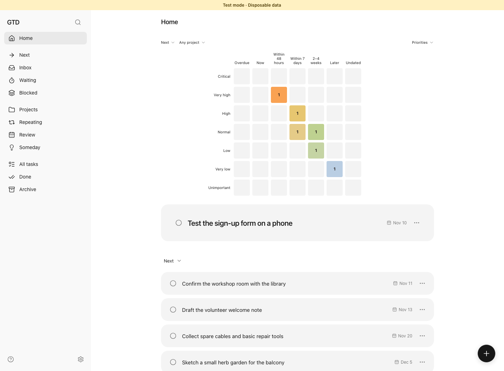
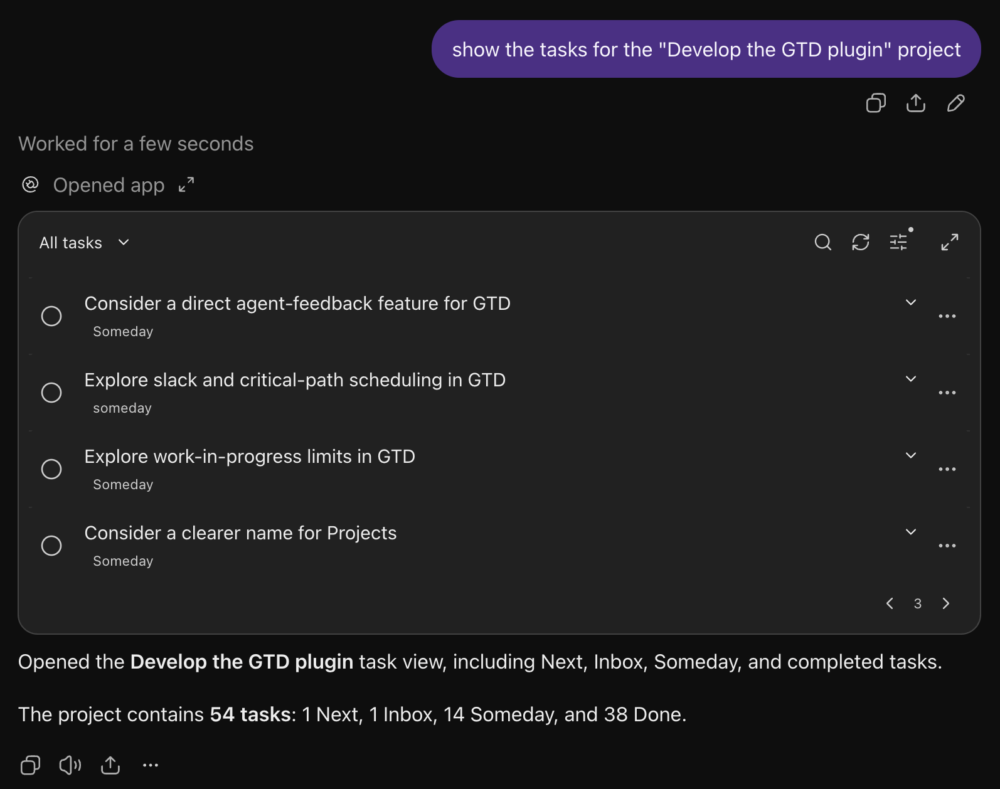
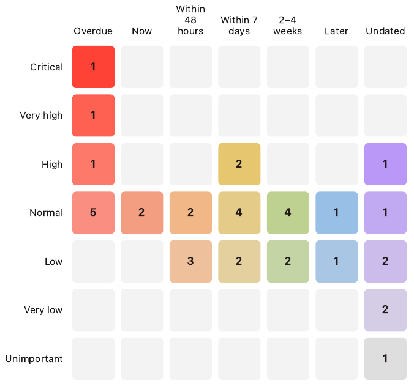
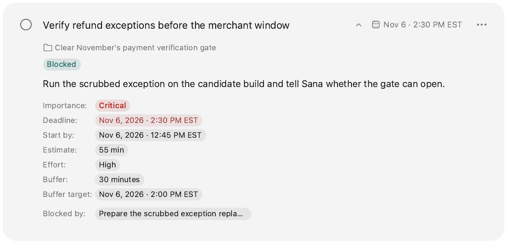
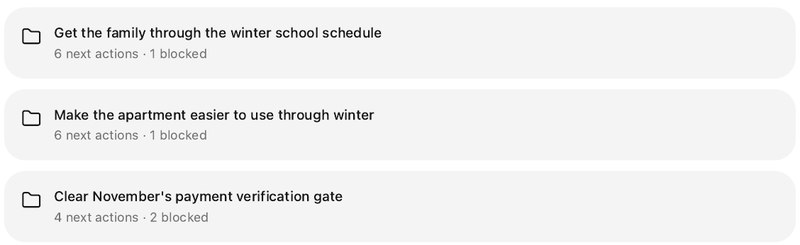
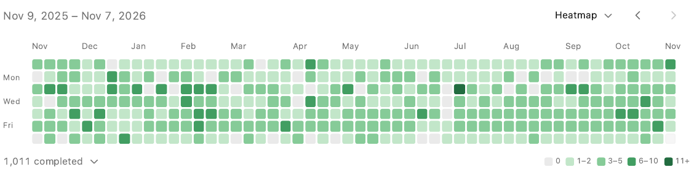
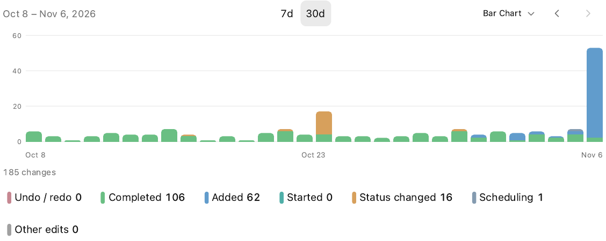
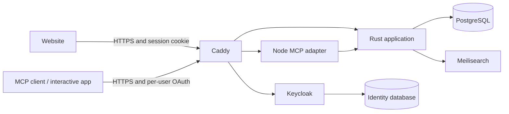

# GTD

**A self-hosted task system for people and AI assistants.**

<p align="center">
  
</p>

## About GTD

GTD combines David Allen's [Getting Things Done](https://en.wikipedia.org/wiki/Getting_Things_Done)
with the urgency-and-importance view of the [Eisenhower matrix](https://en.wikipedia.org/wiki/Time_management#Eisenhower_method).
You talk through your work; your assistant turns it into an organized plan.
It can break a goal into next actions, group them into projects, track blockers,
set deadlines and importance, and arrange work blocks. As plans change, it can
update those details and keep urgent work visible. You don't have to translate
every conversation into forms or maintain all those fields yourself.

Separate agent notes give your assistant somewhere to preserve the working
context behind each task: decisions, progress, open questions, and details it
will need later. It can read those notes and pick up the work without filling
user-facing fields with internal bookkeeping. Your task descriptions stay
readable, and you don't have to reconstruct the backstory every time you start
a fresh chat.

That structure pays off when choosing what to do, too. Effort, estimated duration,
deadlines, dependencies, and priority let your assistant turn an everyday question
into a precise search:

> "I've got twenty minutes before my next meeting. What's a worthwhile task
> that won't take much concentration?"

You can also ask which commitments are waiting on a reply, what needs attention
before a trip, or which small action would unblock an important project. Your
assistant combines the relevant fields to find work that fits the situation.
It builds and maintains that structure from your conversations, so you get the
benefit without taking on another job organizing the data.

GTD puts those details to work even when you aren't asking a question. Its
recommendation algorithm weighs importance, timing, and dependencies to bring
the most pressing available work to the top. As deadlines approach and blockers
clear, the order adapts, so you can see what deserves attention now without
manually rearranging your list.

GTD works best with a persistent, proactive assistant such as **ChatGPT Dot**
that remembers how you like to work and can perform regular reviews and
maintenance. With access to your email, calendar, and other sources of commitments,
your assistant can turn new requests and upcoming events into action items,
then keep projects, dates, and follow-ups current as circumstances change.
You get a useful, detailed system without having to keep feeding and tidying it
yourself: explain what matters, let your assistant organize the details, and get
on with the work.

## Why GTD?

Keeping a detailed task system up to date can become a job of its own. GTD lets
your assistant handle that upkeep. Talk through a project, an idea, or a change
of plan, and your assistant can turn it into concrete actions, dependencies,
dates, and work blocks. Those details help GTD surface what needs your attention
next, without making you maintain every field yourself.

Your tasks also keep the useful context from those conversations: decisions,
progress, unresolved questions, and next steps. A fresh conversation or a
different assistant can read those notes and continue where you left off,
so you spend less time repeating yourself.

Use the website yourself or work through the interactive MCP app in ChatGPT or
Claude. Both use the same tasks and projects, with a separate account for each user.

## Features

### Work in ChatGPT and Claude

The full task workflow is available through the website, MCP tools, and
interactive cards in ChatGPT and Claude. Browse projects, plan work, edit tasks,
and review progress right in the conversation, then pick up the same tasks on the
web whenever you like.



### Priorities

See urgency and importance together. Tasks inherit priority from the work they
block, so a small prerequisite can get the attention a critical outcome deserves.
Select a square to browse its tasks.



### Task Context and Planning

Capture ideas in Inbox and clarify them into specific next actions. Keep a brief,
supporting notes, and agent notes alongside each task. Deadlines, Start by,
availability, estimates, and work blocks give the plan enough detail to be useful.



### Projects and Dependencies

Group actions around an outcome, see what is ready, and track what is waiting or
blocked. Someday keeps possibilities separate from current commitments.



### Activity and Reviews

Look back over a year of completed tasks, or inspect daily activity by the type
of change. Select a date to see the records behind it.





Audit history, undo, version checks, and retry-safe batches make changes
inspectable. Date-filtered history gives assistants the material for a weekly
recap without relying on the current conversation.

## Getting Started

| Goal | Guide |
| --- | --- |
| Run a full installation | [Self-hosting](docs/self-hosting.md) |
| Try the interface or contribute locally | [Development](docs/development.md) |
| Connect ChatGPT, Claude, or another MCP client | [Integrations](docs/integrations.md) |
| Learn the workflow and date semantics | [User guide](docs/user-guide.md) |
| Understand the implementation | [Architecture](docs/architecture.md) |
| Back up, restore, or upgrade | [Operations](docs/operations.md) |

Full self-hosting uses a Linux server, Docker Compose, Python 3.11+, and HTTPS
hostnames you control. The installation creates its own PostgreSQL, Keycloak,
Meilisearch, and application services. No model API key is required to run GTD.
Cloudflare Tunnel is optional. Host subscriptions and connector availability are
controlled by the host provider.

For a local development preview with disposable data:

```sh
npm --prefix web ci
npm --prefix adapter ci
npm --prefix web run build
cargo build --locked
node web/test-server.mjs
```

Open `http://127.0.0.1:18081`. This **test-only** preview has no login and discards
its database when stopped. Use the self-hosting guide for persistent accounts.
Requires Rust 1.93+, Node.js 24+, and a C toolchain.

## System Architecture



The website and the cards inside ChatGPT and Claude use the same React interface.
Both talk to a Rust service that manages tasks, projects, scheduling, and change
history. A Node.js adapter connects MCP clients to that service, so an assistant
changing a task goes through the same business rules as a person using the
interface.

PostgreSQL stores tasks, projects, and their history. Account boundaries are
enforced in the application and through PostgreSQL's row-level security policies.
Meilisearch maintains a separate search index, which can be rebuilt from the
database without affecting the underlying records.

Keycloak handles passwords, sign-in, and OAuth connections. Caddy provides the
HTTPS entry point and routes requests to the website, identity provider, or MCP
adapter. The databases and internal service ports stay on the server's loopback
interface, reachable only from that server. Docker Compose runs the services
together; the installation tooling generates their configuration and credentials.

## Contributing and License

See [CONTRIBUTING.md](CONTRIBUTING.md), [SECURITY.md](SECURITY.md), and
[the documentation index](docs/README.md).

Copyright © 2026 Chris Delvalle. Licensed under [AGPL-3.0-only](LICENSE).
Third-party components retain their own licenses; see [NOTICE](NOTICE).
GTD is independent of David Allen, OpenAI, and Anthropic.
